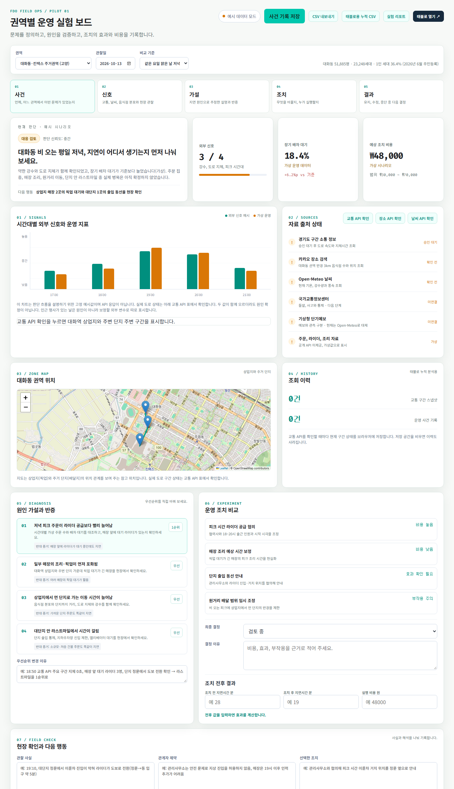

# 권역별 운영 실험 보드

주거가 밀집한 권역의 저녁 피크 배달 병목을 운영 담당자가 직접 검증하도록 돕는 작은 현장 운영 도구입니다. 첫 파일럿은 고양 대화동·킨텍스 주거권역이고, 같은 구조를 대구 달서구 상인·월배·진천 주거권역에 적용했습니다.



이 프로젝트는 배달 지연률을 예측하는 모델이 아닙니다. 공개 교통·날씨 데이터와 음식점 분포를 먼저 확인하고, 라이더 공급 부족, 매장 조리 적체, 원거리 이동, 대단지 라스트마일이라는 원인 가설 네 가지를 비교한 뒤 조치 전후의 지연시간과 실행 비용을 기록합니다.

## 문제 정의

배달 주문의 대부분은 집에서 나옵니다. 주거 권역의 저녁 피크나 비 오는 날 배달이 늦어져도 라이더 공급, 매장 조리, 상업지에서 먼 단지까지의 이동, 단지 안 전달 중 어느 단계가 실제 병목인지 권역 평균만으로는 구분하기 어렵습니다. 원인을 잘못 짚으면 효과 없는 조치와 추가 비용이 반복됩니다.

이 보드는 다음 판단 흐름을 한 화면에 남깁니다.

```text
이상 신호 확인
  → 원인 가설 4개 비교
  → 공개 API와 현장 확인으로 반증
  → 실행안과 관계자 제약 기록
  → 조치 전후 효과와 비용 비교
  → 유지, 수정, 중단 결정
```

## 운영 기록의 다섯 구성요소

| 구성요소 | 기록하는 내용 |
| --- | --- |
| 사건 | 언제, 어느 권역에서 어떤 문제가 있었는지 |
| 신호 | 교통, 날씨, 음식점 분포와 현장 관찰처럼 원인을 판단할 자료 |
| 가설 | 지연 원인이 무엇이라고 추정했는지와 반대 증거 |
| 조치 | 무엇을 바꾸고 관계자와 어떻게 실행했는지 |
| 결과 | 조치 전후 효과와 비용을 보고 유지, 수정, 중단 중 무엇으로 결정했는지 |

화면 상단의 다섯 단계 링크를 누르면 각 기록 영역으로 바로 이동할 수 있습니다.

## 권역 선정 기준: 주거 수요

권역은 행사장이 아니라 **주거 인구**를 기준으로 골랐습니다. 픽업할 역세권 상업지와 배달할 대단지가 가까이 붙어 있어 "매장에서 늦는지, 가는 길에서 늦는지, 단지 안에서 늦는지"를 나눠 볼 수 있는 권역입니다. 킨텍스는 위치를 가리키는 이름이며, 인근 행사일은 원인이 아니라 보정할 외부 변수로 따로 표시합니다.

판단 흐름은 권역에 묶이지 않으므로 `app.js`의 `ZONES` 설정 한 항목으로 권역을 추가합니다.

| 구분 | 고양 파일럿 | 대구 확장 |
| --- | --- | --- |
| 주거 규모(2026.6 주민등록) | 대화동 51,885명 · 23,248세대 · 1인 세대 36.4% | 상인동 58,139명(1인 세대 38.5%) · 월성동 52,297명(28.8%) · 진천동 30,134명(34.3%) |
| 상업지(픽업) | 대화역 주변, 킨텍스 일대 상업시설 | 대구 1호선 상인역·월배역·진천역 주변 |
| 주거지(배달지) | 장성마을 등 대화동 단지, 주변 주상복합 | 상인·월성·진천동 대단지 |
| 교통 자료 | 경기도 구간 소통 정보 API (연결) | 실시간 구간 API 미확인 (미연결) |
| 날씨·음식점·지도 | Open-Meteo, 카카오 장소 검색, OpenStreetMap | 같은 API를 좌표만 바꿔 사용 |

대구는 "역세권 상업지 + 주변 대단지" 배치가 대화동과 가장 비슷한 달서구 상인·월배·진천을 골랐습니다. 상인동은 1인 세대 비율도 대화동과 비슷하고, 월성동은 가족 세대 비중이 높아 별도 비교군으로 봅니다. 수성구 범어·만촌은 주거 규모는 더 크지만 업무지구와 학원가가 섞여 있어 2차 비교 후보로 두었습니다. 비교 과정은 PRD `1-2. 권역 확장`에 있습니다.

인구 수치는 [행정안전부 주민등록 인구통계](https://jumin.mois.go.kr/)의 2026년 6월 원자료(인구 및 세대현황, 세대원수별 세대수)로 확인했습니다. 정리한 값은 [`docs/data/population-2026-06.csv`](docs/data/population-2026-06.csv)에 있습니다.

화면 상단 `권역`에서 대구를 고르면 지도, 인구 문구, 가설 문구, 사건 ID, 날씨와 장소 조회 좌표가 함께 바뀝니다. 대구 교통 API는 연결 전이라 `미연결`로 표시하고 값을 지어내지 않습니다.

## AI 사용과 검산

이 프로젝트는 AI(Claude)로 자료 조사, 문서 초안, 코드 작성을 했습니다. AI가 낸 결과는 그대로 쓰지 않고 원자료나 제 판단으로 다시 확인했습니다. 아래는 실제로 판단을 유지하거나 수정한 기록입니다.

| 날짜 | AI 초안 | 대조한 자료·근거 | 판단 |
| --- | --- | --- | --- |
| 2026-10-17 | 권역 선정 이유를 "킨텍스·엑스코 행사 수요"로 해석하고, 대구 확장 권역으로 엑스코를 제안 | 제가 권역을 고른 실제 기준(주변 주거 인구) | **수정.** 배달 수요는 집에서 나온다는 기준으로 문서와 화면을 다시 쓰고, 행사는 보정 변수로 내림. 대구 권역을 상인·월배·진천으로 다시 고름 |
| 2026-10-17 | 동별 인구·1인 세대 비율을 가공 사이트(k-calc.com)에서 수집 | 행정안전부 주민등록 원자료 2026년 6월 | **유지.** 인구·세대 수 일치. 원자료에서 월성동 1인 세대 28.8%를 새로 확인해, 월성동은 가족 세대 비교군으로 분리 |
| 2026-10-17 | 교통 API 응답의 평균 속도·지체시간·혼잡 등급을 권역 지표로 사용 | 수집한 60행 원자료를 구간별로 다시 집계 | **수정.** 20개 구간이 한 도로뿐이고, 지체시간은 항상 0초, 혼잡 등급은 속도와 불일치함을 확인. 판단 지표를 구간 속도로 바꾸고 노선별 수집을 다음 과제로 둠 |
| 2026-10-17 | 대구 교통 실시간 API 탐색 | 공공데이터포털 검색 결과(대구 ITS 자료는 통계성 자료) | **유지.** 실시간 구간 API를 확인하지 못해 화면에 `미연결`로 두고 값을 만들지 않음 |

## 관찰 사례

사례는 [`field-log/TEMPLATE.md`](field-log/TEMPLATE.md) 양식으로 기록합니다. 관찰 전 가설 순서, 관찰 후 순서, 바꾼 이유를 남깁니다. **아직 현장 방문 사례는 없습니다.** 지금 있는 사례는 공개 API로 수집한 교통·날씨·장소 데이터만으로 쓴 데이터 관찰이며, 매장 앞 라이더 대기나 단지 출입구처럼 직접 봐야 하는 항목은 `확인 못 함`으로 남겼습니다.

| 날짜 | 권역 | 유형 | 바뀐 가설 순서 | 핵심 근거 | 기록 |
| --- | --- | --- | --- | --- | --- |
| 2026-10-17(토) | 대화동·킨텍스 | 데이터 관찰(현장 방문 아님) | 원거리 이동 3위 → 4위, 라스트마일 4위 → 3위 (잠정) | 저녁·밤 평균 속도 차이 4.4km/h, 감속은 4개 구간에 집중. 음식점은 세 지점 반경 1km에 590~680곳으로 고르게 분포 | [사례 #1](field-log/2026-10-17-daehwa-data-observation.md) |

이 사례를 쓰면서 도구 문제 세 가지를 찾았습니다. 교통 20개 구간이 모두 한 도로(`중앙로/수색로`)에서만 뽑혔고, 지체시간 값은 항상 0초였으며, 혼잡 등급이 속도와 맞지 않았습니다. 그래서 판단에는 구간 속도만 씁니다.

## 화면에서 할 수 있는 일

- 권역 전환(고양 대화동·킨텍스, 대구 상인·월배·진천)과 권역 주민등록 인구 표시
- 대화동 주변 교통 구간의 속도, 지체시간과 혼잡 등급 확인
- 권역의 상업지와 주거 단지 위치를 지도에서 확인
- 교통 API 조회 결과를 그 시각의 강수량, 시간대, 평일·주말과 함께 브라우저에 누적 저장
- 저녁 17~21시 조회만 골라 비 오는 때와 맑은 때의 평균 속도·지체를 조회 횟수와 함께 비교
- Open-Meteo에서 현재 기온, 강수량과 풍속 확인
- 권역 중심 반경 3km 음식점 수와 위치 조회
- 원인 가설의 우선순위 변경과 변경 이유 기록(이유 없이 순서만 바꾸면 저장되지 않음)
- 관찰 사실, 관계자 제약과 선택한 조치 기록
- 조치 전후 지연시간과 실행 비용으로 변화율 계산
- 사건 기록을 브라우저에 저장하고 CSV로 내보내기
- 조치 전후 내용을 인쇄 가능한 실험 리포트로 출력
- 누적 교통 데이터를 Tableau용 CSV로 내보내기

## 데이터 경계

| 구분 | 사용 자료 | 화면 표시 방식 |
| --- | --- | --- |
| 실제 공개 데이터 | 경기도 교통정보센터 구간 소통 API | 실제값 |
| 실제 공개 데이터 | 카카오 장소 검색 API | 음식점 위치와 검색 결과 |
| 실제 공개 데이터 | Open-Meteo 현재 날씨 | 기온, 강수량, 풍속 |
| 연결 준비 상태 | 카카오 앱의 지도 및 로컬 서비스 | 서비스가 비활성화되면 확인 필요 |
| 미연결 | 국가교통정보센터, 기상청 단기예보, 대구 교통 데이터 | `미연결`로 표시 |
| 고정 예시값 | 시간대별 신호 차트, 상단 상태 카드 | `예시`, `가상` 표식 |
| 공개되지 않은 내부 자료 | 주문 수, 라이더 수, 조리 완료 시간 | 가상 운영 데이터 |
| 운영자가 입력하는 자료 | 현장 관찰, 제약, 조치 전후 값과 비용 | 사건 기록 |

주문 수나 라이더 공급을 실제 배민 내부 데이터처럼 표현하지 않습니다.

## 실행 방법

필요 조건은 Node.js 18 이상입니다.

### 1. 환경변수 파일 만들기

Windows PowerShell에서 저장소 폴더 안에 입력합니다.

```powershell
Copy-Item .env.example .env
```

`.env`에 발급받은 키를 입력합니다.

```env
GYEONGGI_TRAFFIC_API_KEY=발급받은_경기도_교통_API_키
KAKAO_REST_API_KEY=발급받은_카카오_REST_API_키
```

`.env`는 `.gitignore`에 등록되어 있어 저장소에 올리지 않습니다.

### 2. 서버 실행

```powershell
node server.mjs
```

브라우저에서 [http://localhost:4173/](http://localhost:4173/)을 엽니다.

### 3. API 확인

- 화면의 `교통 API 확인` 버튼으로 대화동 주변 구간을 조회합니다.
- 화면의 `장소 API 확인` 버튼으로 권역 반경 3km 음식점 검색을 확인합니다.
- 화면의 `날씨 API 확인` 버튼으로 현재 기상 신호를 확인합니다. Open-Meteo는 별도 키가 필요하지 않습니다.
- 카카오 API가 오류를 반환하면 카카오 개발자 콘솔에서 앱의 지도 및 로컬 서비스 활성화 여부를 확인합니다.

### 4. 저녁 교통 이력 자동 수집

```powershell
node scripts/collect-traffic.mjs
```

한 번 실행할 때마다 대화동 주변 20개 구간의 속도·지체와 그 시각의 강수량을 `data/traffic-history.csv`에 덧붙입니다. Windows 작업 스케줄러에 17:00부터 21:00까지 30분 간격으로 걸어 두면 버튼을 누르지 않아도 이력이 쌓이고, 보드의 저녁 비교와 `태블로용 누적 CSV`에 함께 반영됩니다.

## Tableau로 이어지는 흐름

1. 여러 날 저녁 17~21시에 교통 API를 30분 간격으로 조회해 이력을 쌓습니다(버튼 또는 `scripts/collect-traffic.mjs`). 비 오는 날과 맑은 날이 모두 있어야 비교할 수 있습니다.
2. `태블로용 누적 CSV`를 내려받습니다.
3. 화면의 `태블로 열기`를 누릅니다.
4. Tableau에서 `regional-ops-traffic-history.csv`를 연결합니다.

현재 버튼은 Tableau Public 탐색 화면으로 연결됩니다. 게시된 워크북 주소가 생기면 링크를 교체할 수 있습니다.

## 개발 중 확인한 범위

2026년 10월 14일 로컬 서버에서 경기도 교통 API를 호출해 대화동 주변 20개 구간 응답을 확인했습니다. 당시 응답의 평균 속도는 27km/h, 평균 지체시간은 0초였습니다. 이 값은 특정 시점의 API 응답이며 권역의 일반적인 성과나 배달 지연률을 의미하지 않습니다.

코드 문법 검사는 다음 명령으로 확인할 수 있습니다.

```powershell
node --check app.js
node --check server.mjs
node --check scripts/collect-traffic.mjs
```

## 저장소 구성

| 파일 | 역할 |
| --- | --- |
| `index.html` | 운영 보드 화면과 입력 흐름 |
| `styles.css` | 화면 스타일과 반응형 레이아웃 |
| `app.js` | 가설, 저장, 효과 계산, CSV 내보내기 |
| `server.mjs` | 화면과 API를 제공하는 로컬 서버 |
| `lib/api.mjs` | 경기도 교통, 카카오 장소, Open-Meteo 호출 로직 |
| `scripts/collect-traffic.mjs` | 저녁 교통 이력을 `data/traffic-history.csv`에 쌓는 수집 스크립트 |
| `data/` | 자동 수집한 교통 이력(공개 API 응답) |
| `.env.example` | 필요한 환경변수 이름만 담은 예시 |
| `PRD-권역-배달병목-운영실험보드.md` | 문제 정의, 요구사항과 구현 현황 |
| `field-log/` | 관찰 기록 양식과 사례(현재는 데이터 관찰 1건) |
| `docs/` | 화면 캡처 |

## 한계와 다음 단계

- 공개 API만으로 배민의 실제 주문 지연률, 라이더 공급, 조리 대기시간을 계산할 수 없습니다.
- 현장 입력값은 운영자가 확인한 사실과 가상 시나리오를 구분해 기록해야 합니다.
- 원인 가설 4개는 아직 고정 템플릿입니다. AI 가설 제안, 위험 상태 자동 판정, 태블로 워크북은 PRD에만 있고 구현하지 않았습니다. 구현 범위는 PRD의 `1-1. 구현 현황`을 기준으로 합니다.
- 단지별 규모·층수와 상업지까지 거리는 아직 화면에 없습니다. 공동주택 공개 정보로 보완할 계획입니다.
- 다음 단계는 비 오는 평일 저녁 현장 관찰 사례 기록, 여러 날짜의 교통 CSV 누적 비교, 대구 교통 데이터 연결입니다.

## 개인정보와 키 관리

개인 주소, 연락처, 차량번호와 공동현관 정보를 기록하지 않습니다. API 키는 `.env`에만 보관하며 GitHub에 올리지 않습니다.
